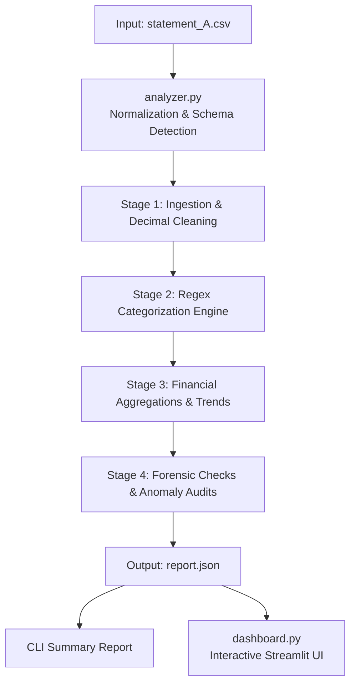

#  Bank Statement Analyzer & Forensic Audit Dashboard

An end-to-end Python financial analysis and audit engine designed to ingest raw bank statement CSVs, compute cash flows, categorize transactions, and detect forensic ledger anomalies (such as mathematical balance breaks, cheque return chains, and circular round-trip transactions). Features both a **Command Line Interface (CLI)** and an interactive **Streamlit Web Dashboard**.

---

##  Technology Stack

| Layer | Technologies | Purpose |
| :--- | :--- | :--- |
| **Language** | **Python 3.8+** | Core language runtime |
| **Interactive UI** | **Streamlit** (`>=1.28.0`) | Modern web dashboard with interactive charts and audit cards |
| **Data Processing** | **Pandas** (`>=2.0.0`) | Dataframe transformations, tabular displays, and charting structures |
| **Financial Precision** | **`decimal.Decimal`** | Exact 2-decimal fixed-point currency math (eliminates float precision flaws) |
| **Pattern Engine** | **`re` (Regular Expressions)** | Merchant categorization, cheque ID extraction, and party normalization |
| **Time & Calendar** | **`datetime`**, **`calendar`** | Multi-format date parsing, calendar range checks, and daily balance simulations |
| **Data Serialization** | **`csv`**, **`json`** | Schema detection, CSV streaming, and structured JSON reporting |
| **Testing Suite** | **`unittest`** / **`pytest`** | Unit testing covering ingestion, rules, calculations, and JSON export |

---

## Architecture & Pipeline Flow



---

##  How the Logic Works (Step-by-Step)

When a bank statement CSV is provided, `analyzer.py` processes it through four sequential stages:

### 1. Ingestion & Schema Normalization (`load_csv` & `money`)
- **Dynamic Header Detection**: Automatically identifies common bank column variations regardless of casing or formatting (`date`, `description`/`narration`/`particulars`, `debit`/`credit` or `amount`/`type`, `balance`).
- **Exact Monetary Quantization (`money`)**: Converts strings containing currency symbols, commas, or parentheses (e.g. `(500.00)`) into exact 2-decimal `Decimal` objects.
- **Opening Balance Isolation**: Recognizes zero-movement lines (e.g. `2026-04-01,OPENING BALANCE,,,300000.00`) as baseline starting milestones without counting them as active ₹0 expense transactions.

### 2. Auto-Categorization (`auto_categorize`)
Each narration is evaluated against regex keyword patterns:
- **Rent & Facilities**: `rent`, `lease`, `property`, `royal estates`
- **Loan & EMI**: `loan`, `emi`, `ecs dr`, `interest`
- **Payroll & Salary**: `salary`, `payroll`, `wage`, `batch payout`
- **Taxes & Compliance**: `gst`, `tax`, `challan`, `tds`
- **Utilities**: `electricity`, `telecom`, `power`, `internet`, `isp`
- **Logistics & Transport**: `transport`, `logistics`, `fuel`, `metro fuel`
- **Bank Charges & Fees**: `rtn chgs`, `chq rtn`, `bank charge`, `fee`
- **Revenue & Inflows**: `neft-cr`, `upi-cr`, `chq dep`, `sales`
- **Dining / Groceries / Entertainment / Healthcare**: Keyword fallbacks for retail merchants.

### 3. Financial Analytics & Summaries (`analyze`)
- **Cash Flow**: Computes Total Income, Total Expenses, Net Cash Flow, and Savings Rate:
  $$\text{Net Cash Flow} = \text{Total Income} - \text{Total Expenses}$$
  $$\text{Savings Rate \%} = \left(\frac{\text{Net Cash Flow}}{\text{Total Income}}\right) \times 100$$
- **Category Spending**: Aggregates total expenditure, percentage share of expenses, and average ticket size.
- **Monthly Trends**: Groups cash flow by calendar month (`YYYY-MM`) for trend tracking.
- **Recurring Expenses**: Detects recurring fixed payments (e.g. Rent of ₹45,000 paid monthly, Loan EMI of ₹38,250 paid monthly).
- **Top Expenses**: Identifies the 5 largest single outflows.

### 4. Forensic & Audit Checks
The engine executes four specialized audit routines:

#### A. Monthly Average Balance (MAB / ADB) (`calculate_monthly_average`)
Banks calculate minimum average monthly balance based on the balance at the end of **every calendar day**:
- On transaction days, it records the final closing balance of that day.
- On non-banking days (weekends/holidays), it carries forward the prior day's closing balance.
- It sums all daily balances for the entire month and divides by total calendar days (30 or 31).

#### B. Balance Continuity & Break Detection (`find_balance_breaks`)
Audits mathematical continuity across every sequential transaction:
$$\text{Expected Balance} = \text{Previous Balance} + \text{Credit} - \text{Debit}$$
If $\text{Expected Balance} \neq \text{Printed Balance}$, it flags the line number, discrepancy amount, and description.

#### C. Cheque Bounce Tracing (`find_bounced_cheques`)
Extracts unique cheque serial numbers (e.g. `100349`) and links multi-step lifecycles:
$$\text{Cheque Deposit} \longrightarrow \text{Cheque Return (Insufficient Funds)} \longrightarrow \text{Return Penalty Charges}$$

#### D. Round-Trip Detection (`find_round_trips`)
Flags suspicious circular fund movements commonly used to inflate turnover:
- Condition: Incoming credit $\ge ₹1,00,000$ followed by an outgoing debit of the **exact same amount** to the **same counterparty** within **48 hours**.

---

##  Repository Structure

```text
bank-statement-analyzer/
├── analyzer.py          # Core parsing, categorization, audit checks & CLI engine
├── dashboard.py         # Streamlit interactive web dashboard
├── test_analyzer.py     # Comprehensive unit test suite (9 test cases)
├── statement_A.csv      # Sample multi-month commercial bank statement (240 transactions)
├── report.json          # Machine-readable output containing analysis & audit flags
├── requirements.txt     # Python package dependencies (pandas, streamlit, pytest)
├── .gitignore           # Git ignore configurations
└── README.md            # Complete documentation
```

---

##  Getting Started

### 1. Installation

Clone the repository and install dependencies:

```bash
git clone https://github.com/your-username/bank-statement-analyzer.git
cd bank-statement-analyzer

pip install -r requirements.txt
```

### 2. Run the Analyzer (CLI)

Analyze `statement_A.csv` and export results to `report.json`:

```bash
python analyzer.py statement_A.csv -o report.json
```

**Terminal Output Preview:**
```text
BANK STATEMENT ANALYSIS REPORT
=================================================================
Transactions: 240
Total income: 13,427,413.99
Total expenses: 6,154,470.18

REQUIRED CHECKS
Monthly averages: 6
Bounced cheques: 3
Round trips: 2
Balance breaks: 1
Invalid rows: 0
=================================================================
Report saved to: report.json
```

### 3. Launch the Web Dashboard (Streamlit UI)

Launch the interactive dashboard in your browser:

```bash
streamlit run dashboard.py
```

Features included in the dashboard:
- **Top Financial KPI Cards**: Income, Expenses, Net Cash Flow, Savings Rate, Ending Balance.
- **Monthly Trends**: Comparative bar chart of Income vs Expenses, and Net Savings trend line.
- **Expense Category Breakdown**: Interactive category chart and structured table.
- **Audit & Forensic Flags**: Expanders showing detailed breakdown of Bounced Cheques, Round Trips, and Balance Breaks.

---

##  Running Unit Tests

Run the test suite via `pytest` or `unittest`:

```bash
# Using pytest
pytest test_analyzer.py -v

# Or using Python's test runner
python -m unittest -v test_analyzer
```

**Test Coverage:**
- Amount & currency cleaning (`_clean_amount`, currency symbols, parentheses)
- Date parsing across multiple formats (`_parse_date`)
- Keyword & explicit categorization (`auto_categorize`)
- Schema detection for separate Debit/Credit and single Amount/Type formats
- Missing file & invalid CSV schema validation
- Financial calculations, monthly trends, and recurring transaction identification
- JSON export integrity

---

## 📄 Output Schema (`report.json`)

```json
{
  "summary": {
    "statement_period": { "start_date": "2026-04-01", "end_date": "2026-09-29", "total_days": 182 },
    "total_transactions": 240,
    "total_income": 13427413.99,
    "total_expenses": 6154470.18,
    "net_cash_flow": 7272943.81,
    "savings_rate_pct": 54.16,
    "starting_balance": 300000.0,
    "ending_balance": 7597943.81
  },
  "monthly_average_balance": {
    "2026-04": { "days": 30, "average_daily_closing_balance": "1320098.53" }
  },
  "bounces": [
    {
      "cheque_number": "100349",
      "deposit_line": 19,
      "return_line": 27,
      "charge_line": null,
      "return_date": "2026-04-18"
    }
  ],
  "round_trips": [
    {
      "counterparty": "TARA VENTURES",
      "amount": "360000.00",
      "credit_line": 190,
      "debit_line": 194,
      "credit_date": "2026-08-20",
      "debit_date": "2026-08-22",
      "hours_apart": 48.0
    }
  ],
  "balance_breaks": [
    {
      "line_number": 205,
      "date": "2026-09-05",
      "description": "NEFT-DR-ROYAL ESTATES RENT",
      "expected_balance": "6062332.52",
      "printed_balance": "6087332.52",
      "difference": "25000.00"
    }
  ]
}
```

---

##  License

MIT License. Free for educational, commercial, and personal use.
